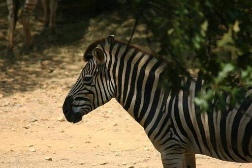
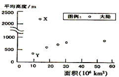
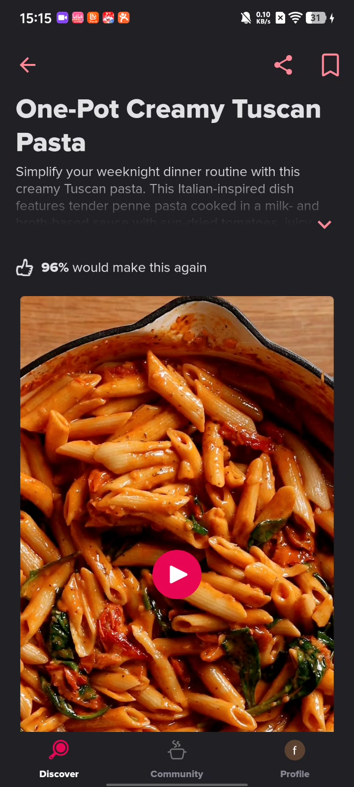

<div align="center">

# MM-JevBench

### Benchmarking Calibrated Multimodal Choice Decisions and Jev Coherence

[](https://github.com/Hesene/MM-JevBench)
[](#dataset-scale)
[](#test-accuracy)
[](#task-design)

**English** · **[简体中文](README.zh-CN.md)**

</div>

MM-JevBench is a multimodal benchmark for candidate-based decision models. A model reads images, text, audio, video, or GUI interaction history and returns a complete probability distribution over a declared set of candidates.

The current release is `MM-JevBench-10k-v1.0`.

> **At a glance:** 5 data sources · 10,000 canonical samples · 2,000 dev · 8,000 test · 8,079 leakage-controlled groups

## Navigation

[Dataset scale](#dataset-scale) · [Task design](#task-design) · [Candidate construction](#candidate-design-and-construction) · [Model results](#evaluated-models) · [Cases](#representative-cases) · [Build protocol](#build-protocol) · [Data files](#data-files) · [Quick validation](#quick-validation)

## Dataset Scale

| Track | Source | Canonical | Dev | Test | Groups |
|---|---|---:|---:|---:|---:|
| Academic reasoning | CMMMU | 760 | 152 | 608 | 752 |
| Chinese exam reasoning | MULTI v1.3.1 | 4,994 | 999 | 3,995 | 4,994 |
| GUI action decision | OmniGUI | 2,572 | 514 | 2,058 | 708 |
| General multimodal reasoning | MMBench-Dev-CN | 1,164 | 233 | 931 | 1,121 |
| Chinese culture reasoning | CCBench | 510 | 102 | 408 | 504 |
| **Total** | **5 sources** | **10,000** | **2,000** | **8,000** | **8,079** |

Every canonical sample is a closed-set choice decision. Standard visual tasks contain 2–7 candidates, while OmniGUI uses 13 fixed action types. Gold answers are the unique upstream labels represented as one-hot `outcome_distribution` values. A model must return candidate probabilities that sum to one.

## Task Design

| Task type | Source | Samples | Candidates | Decision evidence |
|---|---|---:|---:|---|
| Academic visual multiple choice | CMMMU | 655 | 4 | Image, question, and subject knowledge |
| Academic visual true/false | CMMMU | 105 | 2 | Image, question, and subject knowledge |
| Chinese exam multiple choice | MULTI | 4,994 | 2–7 | Image, question, and exam knowledge |
| General visual multiple choice | MMBench-Dev-CN | 1,164 | 2–4 | Image and text question |
| Chinese culture multiple choice | CCBench | 510 | 4 | Image, text, and cultural knowledge |
| GUI next-action decision | OmniGUI | 2,572 | 13 | Current interface, multimodal context, and action history |

The candidate-count distribution is: 783 two-option samples, 108 three-option samples, 6,534 four-option samples, 2 five-option samples, 1 seven-option sample, and 2,572 thirteen-option samples. Every task uses `task_type: "choice"`, while `domain`, `source.dataset`, and upstream metadata are retained for capability- and source-level reporting.

## Candidate Design and Construction

- **Native upstream candidates:** CMMMU, MULTI, MMBench-Dev-CN, and CCBench retain their original candidate content. No synthetic distractors are added; only option markers, whitespace, and letter case are normalized.
- **Normalized true/false decisions:** CMMMU true/false questions use two standardized candidates, “False” and “True,” with the upstream answer mapped to the corresponding index.
- **Closed-set GUI actions:** OmniGUI next actions are mapped to 13 fixed candidates: `WAIT`, `TAP`, `DOUBLE_TAP`, `LONG_PRESS`, `SWIPE_UP`, `SWIPE_DOWN`, `SWIPE_LEFT`, `SWIPE_RIGHT`, `INPUT`, `BACK`, `HOME`, `TASK_COMPLETE`, and `TASK_IMPOSSIBLE`. Coordinates and typed text remain in metadata and do not create additional candidates.
- **Unified candidate representation:** Each candidate contains a `key`, `text`, and optional `value`. Standard tasks generally use A/B/C-style keys; GUI `value` fields preserve the upstream action code.
- **Fixed canonical order:** Canonical records preserve the upstream candidate order. The coherence suite creates deterministic permutations for `REP` relations and remaps gold labels accordingly; these variants are not counted among the 10,000 canonical samples.
- **Gold and model scores:** `label_index` and `label_key` identify the unique correct candidate. `outcome_distribution` is a one-hot encoding of the upstream gold label. Evaluated models must assign every candidate a probability in `[0,1]`, with probabilities summing to one. The current one-hot targets should not be interpreted as human subjective uncertainty.

Minimal candidate and prediction representation:

```json
{
  "candidates": [
    {"key": "A", "text": "Candidate A", "value": null},
    {"key": "B", "text": "Candidate B", "value": null}
  ],
  "label_index": 1,
  "label_key": "B",
  "outcome_distribution": [0.0, 1.0],
  "prediction": {"probabilities": [0.15, 0.85]}
}
```

## Evaluated Models

| Model | Parameters | Multimodal decision interface | Official weights |
|---|---:|---|---|
| [Clef](https://huggingface.co/Cloudflare/clef) | 27B | Image/video input, typed questions, direct candidate probabilities | [Cloudflare/clef](https://huggingface.co/Cloudflare/clef/tree/main) (BF16 Safetensors, Apache-2.0) |
| [JEV-27B-VL](https://huggingface.co/autotrust/JEV-27B-VL) | 27B | Jev-style text-and-image choice decisions with a complete candidate distribution | [autotrust/JEV-27B-VL](https://huggingface.co/autotrust/JEV-27B-VL/tree/main) (BF16 shards plus decision adapter/head, Apache-2.0) |
| [Clef-Flash](https://huggingface.co/Cloudflare/clef-flash) | 9B | Image/video input with a Jev/SystemOne-compatible typed-decision interface | [Cloudflare/clef-flash](https://huggingface.co/Cloudflare/clef-flash/tree/main) (BF16 Safetensors, Apache-2.0) |

### Test Accuracy

The following numbers are zero-shot multimodal candidate-decision accuracies. Candidate sets and input templates were held constant across the three models.

#### Overall Leaderboard

| Model | Mean accuracy across datasets<br><sub>20% per dataset</sub> | Sample-weighted mean<br><sub>8,000 test samples</sub> |
|:---|---:|---:|
| **JEV-27B-VL** | 🥇 **74.24%** | 70.10% |
| **Clef** | 74.22% | 🥇 **70.90%** |
| **Clef-Flash** | 69.90% | 64.83% |

#### Per-Dataset Results

| Dataset | Test samples | Clef | JEV-27B-VL | Clef-Flash |
|:---|---:|---:|---:|---:|
| CMMMU | 608 | 63.9% | 🥇 **65.8%** | 62.8% |
| CCBench | 408 | 81.4% | 🥇 **82.6%** | 81.4% |
| MULTI | 3,995 | 🥇 **69.2%** | 68.7% | 65.9% |
| MMBench-Dev-CN | 931 | 91.9% | 🥇 **92.7%** | 91.3% |
| GUI action decision | 2,058 | 🥇 **64.7%** | 61.4% | 48.1% |

The dataset-level mean gives each of the five datasets a 20% weight so that the larger MULTI and GUI sets do not dominate the conclusion. The sample-weighted mean uses the number of test samples in each dataset. Because the provided per-dataset accuracies are rounded to one decimal place, the weighted means are approximate.

### Representative Cases

The following are three real samples from the test split. For readability, their preview images are stored separately under `docs/assets/readme/`; the Parquet files still contain only relative references into the complete media package and do not embed media bytes.

#### Case 1 · General visual spatial relation

<table>
  <tr>
    <td width="46%" align="center"><br><sub>MMBench-Dev-CN · spatial relation</sub></td>
    <td width="54%"><strong>Question</strong><br>Where is the zebra? (<code>斑马在哪里？</code>)<br><br><strong>Candidates</strong><br>A · On the right<br>B · On the left<br>C · At the top<br>D · At the bottom<br><br><strong>Gold　A · On the right</strong></td>
  </tr>
</table>

<details><summary>Sample metadata and media path</summary><br><strong>ID:</strong> <code>mmjev_mmbench_dev_cn_1000</code><br><strong>Source:</strong> MMBench-Dev-CN<br><strong>Image:</strong> <code>datasets/media/mmbench_dev_cn/a0/a03f851109b2cfafd34a05a5cb687dafbae5435f6f7a59df2a66f1eb30a012c8.jpg</code></details>

#### Case 2 · Chinese exam visual reasoning

<table>
  <tr>
    <td width="46%" align="center"><br><sub>MULTI · high-school geography</sub></td>
    <td width="54%"><strong>Question</strong><br>Continent Y is <code>[MASK]</code> (<code>Y 大陆是 [MASK]</code>)<br><br><strong>Candidates</strong><br>A · Eurasia<br>B · Australia<br>C · North America<br>D · South America<br><br><strong>Gold　B · Australia</strong></td>
  </tr>
</table>

<details><summary>Sample metadata and media path</summary><br><strong>ID:</strong> <code>mmjev_multi_gzdl_3_1</code><br><strong>Source:</strong> MULTI (high-school geography)<br><strong>Image:</strong> <code>datasets/media/multi/gzdl/3_1.png</code></details>

#### Case 3 · GUI next-action decision

<table>
  <tr>
    <td width="38%" align="center"><br><sub>OmniGUI · Tasty · T0505 / step 0</sub></td>
    <td width="62%"><strong>Task</strong><br>Save this recipe (<code>收藏该食谱。</code>)<br><br><strong>Question</strong><br>Based on the current multimodal state and action history, which action type should be selected next?<br><br><strong>Candidate space</strong><br>13 fixed actions: <code>WAIT</code>, <code>TAP</code>, <code>DOUBLE_TAP</code>, <code>LONG_PRESS</code>, four swipe directions, <code>INPUT</code>, <code>BACK</code>, <code>HOME</code>, <code>TASK_COMPLETE</code>, and <code>TASK_IMPOSSIBLE</code><br><br><strong>Gold　B · TAP</strong></td>
  </tr>
</table>

<details><summary>Sample metadata and media path</summary><br><strong>ID:</strong> <code>mmjev_omnigui_3dae6b3d0adbb2d668dd</code><br><strong>Source:</strong> OmniGUI (Tasty, episode <code>T0505</code>, step 0)<br><strong>Multimodal input:</strong> screenshot, audio, and video from the same step<br><strong>Screenshot:</strong> <code>datasets/media/omnigui/tasty/media/T0505/1.png</code></details>

Only aggregate accuracy has been released so far. Per-sample candidate probabilities from the three models are not yet available, so this README does not display or infer individual model outputs for these cases. Once prediction JSONL files are released, complete candidate distributions can be added to the same cases.

## Build Protocol

1. **Pin source versions:** Record the revision, original file size, and SHA-256 for every source.
2. **Normalize the schema:** Convert questions, media, candidates, gold labels, provenance, sampling metadata, and `group_id` into unified JSONL records.
3. **Apply eligibility filters:** Retain only samples with public gold labels, valid candidates, and valid media references. CircularEval rotations are excluded from MMBench and CCBench.
4. **Sample deterministically:**
   - CMMMU includes valid multiple-choice and true/false questions.
   - MULTI is stratified by `subject × image_bin × Elite` and sampled from unique problem groups.
   - OmniGUI includes every valid action step.
   - MMBench-Dev-CN and CCBench use their canonical sets after rotation duplicates are removed.
5. **Split by group:** Shared media, problems, and GUI episodes define groups. A group may not cross dev and test. The final release contains 2,000 dev and 8,000 test records with zero cross-split group leakage.
6. **Preserve the nested anchor:** IDs and splits from the earlier 1,500-sample anchor are retained. New samples are added deterministically from the remaining sampling frame.
7. **Deduplicate across sources:** Normalized text, image SHA-256, and perceptual hashes are jointly screened. No cross-source exact duplicate currently requires removal.

See [`docs/sampling_protocol_10k.md`](docs/sampling_protocol_10k.md) for the complete sampling protocol and [`docs/data_sources.md`](docs/data_sources.md) for pinned source versions.

## Data Files

| File | Contents |
|---|---|
| `datasets/processed/10k/mmjevbench_10k.jsonl` | All 10,000 canonical records |
| `datasets/parquet/dev.parquet` | 2,000 dev records for direct loading and inspection |
| `datasets/parquet/test.parquet` | 8,000 test records for direct loading and inspection |
| `datasets/coherence/10k/relations.jsonl` | 54,508 Jev coherence relations |
| `datasets/manifests/10k/release_media.jsonl` | 15,718 media references with SHA-256 hashes |
| `schemas/mmjevbench.schema.json` | Unified data schema |

The upstream media package is approximately 6.1 GB and is not committed to GitHub. Media paths, hashes, and reconstruction information are retained in the manifest and conversion scripts. Coherence variants that exceed GitHub's per-file limit can be rebuilt deterministically from the canonical data.

## Quick Validation

```powershell
python -m venv .venv
.\.venv\Scripts\python -m pip install -e ".[dev]"
.\.venv\Scripts\python scripts\validate_dataset.py datasets\processed\10k\mmjevbench_10k.jsonl
.\.venv\Scripts\python -m pytest
```

## Data Sources and Licensing

MM-JevBench draws from CMMMU, MULTI-Benchmark, OmniGUI, MMBench-Dev-CN, and CCBench. The unified annotations and code do not replace or alter the original licenses of upstream questions and media. Review [`docs/data_sources.md`](docs/data_sources.md) before use or redistribution.

## Citation

If you use MM-JevBench in your research, please cite this repository:

```bibtex
@misc{mmjevbench2026,
  title        = {MM-JevBench: Benchmarking Calibrated Multimodal Choice Decisions and Jev Coherence},
  author       = {Hesene},
  year         = {2026},
  howpublished = {\url{https://github.com/Hesene/MM-JevBench}},
  note         = {Version 1.0}
}
```

Repository: <https://github.com/Hesene/MM-JevBench>

---

<div align="center">

**[Back to top](#mm-jevbench)** · **[简体中文](README.zh-CN.md)**

</div>
